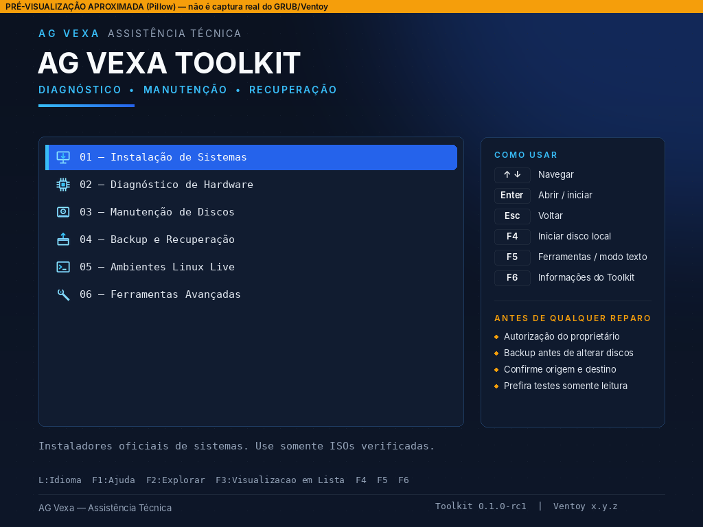

# AG Vexa Toolkit

**AG Vexa — Assistência Técnica** · *Diagnóstico • Manutenção • Recuperação*

Central profissional de ferramentas inicializáveis para um HD externo de 1 TB,
baseada no **Ventoy**, com identidade visual AG Vexa (tema escuro), catálogo
de ferramentas verificadas, scripts de preparação seguros, manual do técnico
em português e o módulo **AG Vexa Windows Optimizer** para pós-formatação.

> **Versão 0.1.0-rc1 — candidata para homologação.** Testes de boot em
> VM/hardware e do Optimizer em Windows ainda **não foram executados**.
> A instalação no HD (Fase F) depende de autorização do proprietário.
> Ver [`docs/relatorio-de-validacao.md`](docs/relatorio-de-validacao.md).



*(pré-visualização aproximada gerada com Pillow — não é captura real do GRUB)*

## Início rápido (no servidor, sem sudo)

```bash
cd ~/agvexa-toolkit                       # ou o diretório onde o projeto foi clonado
bash scripts/preflight.sh                 # verifica o ambiente (somente leitura)
bash scripts/test-boot.sh                 # executa os testes automatizados
cp catalog/isos-manifest.example.json catalog/isos-manifest.json
#   baixe as ISOs das fontes oficiais para isos/, preencha os SHA-256 oficiais
bash scripts/verify-isos.sh               # VERIFICADA / NAO_VERIFICADA / DIVERGENTE ...
bash scripts/prepare-staging.sh           # monta build/staging (cópia exata do HD)
bash scripts/validate-config.sh --staging build/staging
#   instalação física: docs/instalacao-segura.md (manual, com autorização)
```

Todos os scripts têm `--help`. Nenhum acessa discos, usa `sudo` ou altera o servidor.

## Menu no boot

```
01 — Instalação de Sistemas      Windows 11 / Windows 10 (fim de suporte)
02 — Diagnóstico de Hardware     MemTest86+
03 — Manutenção de Discos        GParted Live
04 — Backup e Recuperação        Rescuezilla
05 — Ambientes Linux Live        SystemRescue (SMART, TestDisk, PhotoRec, ddrescue, rede), Ubuntu
06 — Ferramentas Avançadas       Clonezilla
F6 — Informações do Toolkit, regras de segurança, identificação, reiniciar/desligar
F5 — Tema leve, resolução, modo texto (recursos do Ventoy)
```

Na raiz do HD também ficam as pastas de apoio para usar com o Windows aberto:
`DRIVERS`, `INSTALADORES`, `FERRAMENTAS` e `BIOS_FIRMWARE` (cada uma com LEIA-ME e
`INVENTARIO.csv`). Dados de clientes **não** ficam no HD do toolkit: ver
[`docs/instalacao-segura.md`](docs/instalacao-segura.md), seção 10.

Categorias sem ferramenta instalada **não aparecem**. Só ISOs com SHA‑256 oficial
conferido entram por padrão.

## Estrutura

| Pasta | Conteúdo |
|---|---|
| `docs/` | arquitetura, instalação segura, manual do técnico, procedimentos, ferramentas, compatibilidade, riscos, manutenção, licenças, segurança, validação, Windows Optimizer |
| `branding/` | paleta, fundos, ícones, fontes livres e licenças, logomarca oficial |
| `ventoy/` | `ventoy.json` (gerado), `ventoy_grub.cfg` (F6), temas `agvexa` e `agvexa-lite` |
| `catalog/` | categorias do menu, catálogo de ferramentas, manifesto de ISOs (exemplo) |
| `media-layout/` | arquivos da raiz do HD (LEIA-ME, `.ventoyignore`) |
| `scripts/` | preflight, validação, verificação de ISOs, staging, testes, relatórios |
| `templates/relatorios/` | diagnóstico, checklists, testes finais, entrega |
| `windows-optimizer/` | AG Vexa Windows Optimizer (PowerShell 5.1+) |
| `tests/` | testes automatizados |
| `extras/` | arquivos reais de DRIVERS, INSTALADORES, FERRAMENTAS e BIOS_FIRMWARE (**fora do Git**) |
| `isos/`, `build/`, `reports/` | locais, **fora do Git** |

## Documentos principais

- [Arquitetura e decisões](docs/arquitetura.md)
- [Manual do Técnico](docs/manual-do-tecnico.md) · [Procedimentos de atendimento](docs/procedimentos-de-atendimento.md)
- [Instalação segura no HD (Fase F)](docs/instalacao-segura.md)
- [Windows Optimizer](docs/windows-optimizer.md)
- [Riscos e limitações](docs/riscos-e-limitacoes.md) · [Segurança](docs/relatorio-de-seguranca.md) · [Licenças](docs/licencas.md)
- [Progresso e pendências](PROGRESSO.md) · [Changelog](CHANGELOG.md)

## Requisitos

Obrigatórios: Bash, Python 3.8+, `sha256sum`. Opcionais: Pillow (regerar imagens),
PyYAML (validar o catálogo YAML), QEMU+OVMF (testes em VM), pwsh e shellcheck
(análises extras). Nenhum pacote é instalado pelos scripts.

## Licenças

Ferramentas de terceiros mantêm suas licenças e **não são redistribuídas** por este
repositório (ISOs ficam fora do Git). Ver [`docs/licencas.md`](docs/licencas.md).
